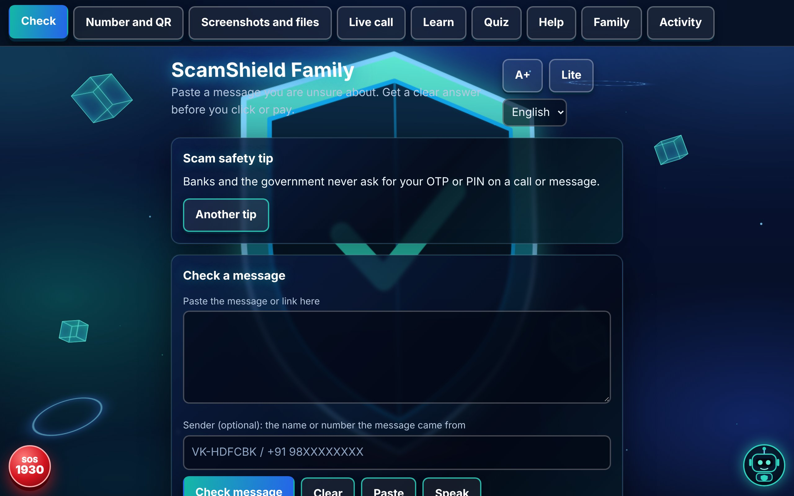
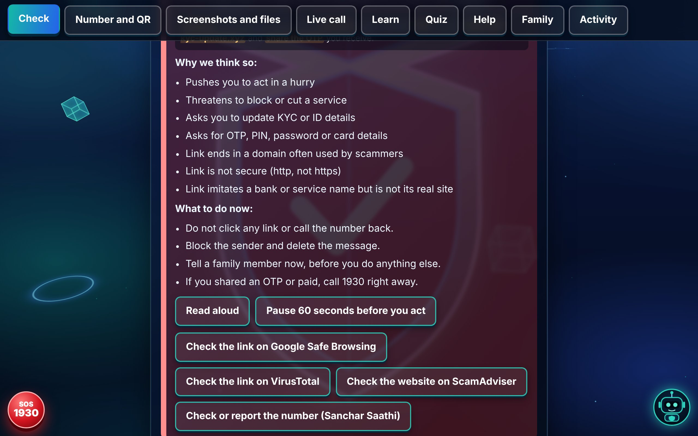
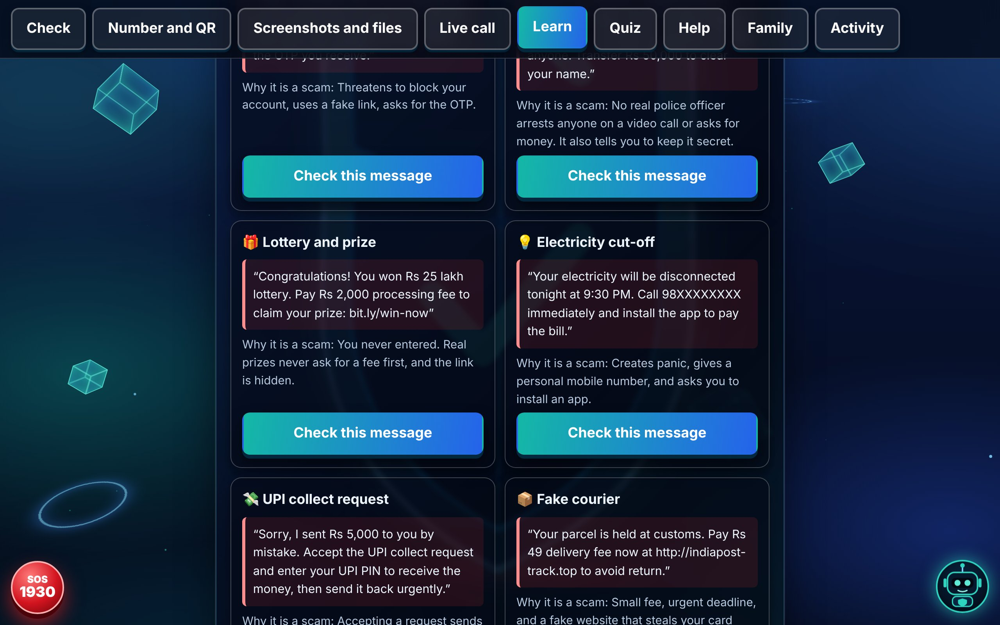
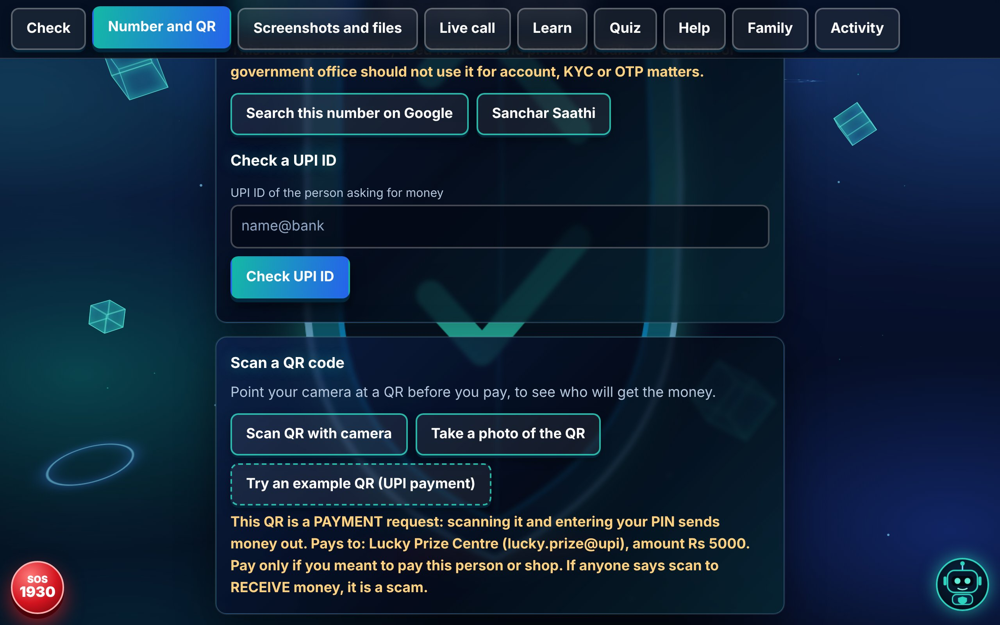
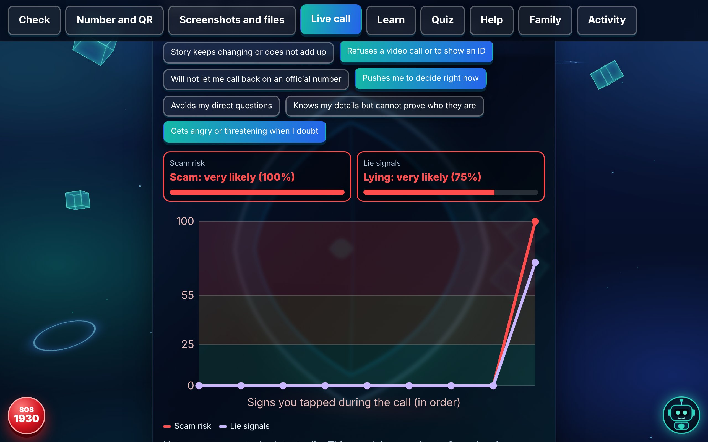
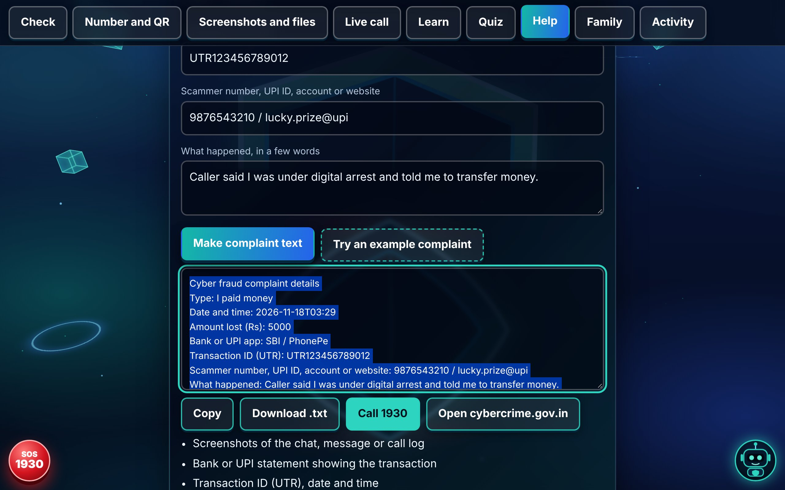
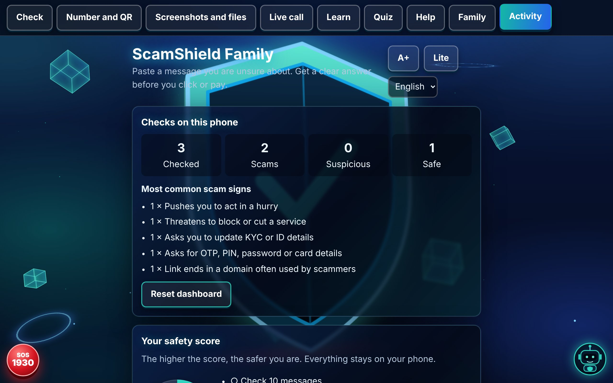
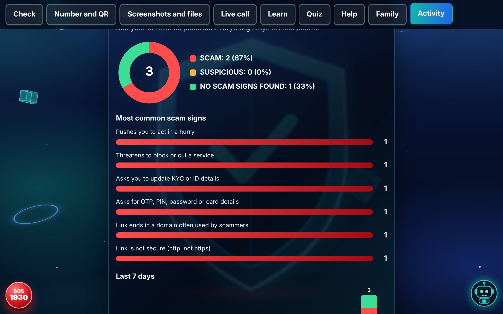

# ScamShield Family

**Offline-first scam protection app for families in India. Check messages, calls, numbers and QR codes before you lose money.**

Live demo: https://golden-phoenix-c1b67c.netlify.app
Demo video: https://youtu.be/894ZNJ-I6N0

---

## The problem
Every day, families in India lose money to digital arrest calls, fake KYC messages, UPI "sent by mistake" requests and fake job or investment offers. Elderly family members are the most at risk and often cannot tell a scam from a real message.

## What ScamShield Family does
Paste or upload a suspicious SMS, WhatsApp message, call, phone number or QR code. ScamShield tells you whether it looks like a **scam** or **real**, explains why, and shows what to do next.

### Features
- Check **SMS**, **WhatsApp** and **Call** content
- **Phone number** and **QR code** checks
- **Live call** analysis with a risk graph
- Scam examples and guides: digital arrest, KYC and OTP, UPI collect request, fake job or investment
- **Help and complaint kit** with one-tap **1930** helpline and Sanchar Saathi link
- **Activity score** and graphs of what you have checked
- Guide assistant to walk families through each step
- **Hindi and English**
- Mobile friendly and works offline-first

## Screenshots
| | |
|---|---|
|  |  |
|  |  |
|  |  |
|  |  |

## Try it yourself
Sample files are in [`/demo-samples`](./demo-samples). Upload each one on the matching tab:

| File | Upload on | Expected result |
|---|---|---|
| `1_SMS_scam.png` | SMS tab | Scam |
| `2_WhatsApp_scam.png` | WhatsApp tab | Scam |
| `3_Call_scam.mp3` | Call tab | Scam |
| `4_QR_scam.png` | QR | Scam |
| `5_SMS_REAL_optional.png` | SMS tab | Safe |

All names, numbers, UPI IDs and links in the samples are fictional.

## How it works
1. Choose SMS, WhatsApp, Call, number or QR.
2. Paste or upload the content.
3. The app looks for scam signals: urgency, threats, requests for OTP, PIN or CVV, suspicious links, payment requests and secrecy demands.
4. It shows a verdict with reasons and safety advice.

## Tech stack
<EDIT THIS: for example HTML, CSS, JavaScript, any model or library used, Netlify for hosting>

## Run locally
```bash
git clone https://github.com/hackathonnew23-ship-it/scamshield-family.git
cd scamshield-family
# open index.html in a browser
```

## If you are scammed
- Call **1930** immediately (National Cyber Crime Helpline)
- Report at https://cybercrime.gov.in
- Report suspicious numbers at https://sancharsaathi.gov.in
- Call your bank right away to block cards or UPI

Police, CBI and banks never ask for OTP, PIN or CVV, never "digitally arrest" anyone on a video call, and never ask you to pay to clear your name.

## Disclaimer
ScamShield Family is a demonstration project. Results are guidance only and may be wrong. Always verify with your bank or official sources before sending money.

## Team
<EDIT THIS: names, college, roles>

## License
MIT. See [LICENSE](./LICENSE).
